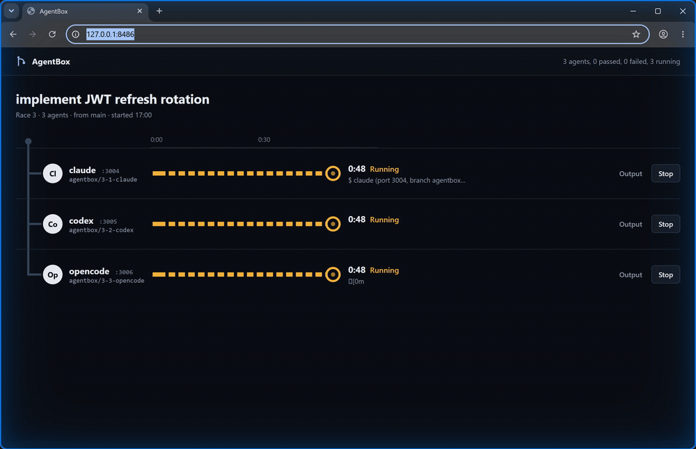

# AgentBox

Run parallel coding agents in isolated Git worktrees from a single 13 MB Go binary.

[](https://goreportcard.com/report/github.com/jeeqe/agentbox)
[](https://github.com/jeeqe/agentbox/releases)
[](LICENSE)




## Quickstart

```bash
# install (or grab a release binary from the Releases page)
go install github.com/jeeqe/agentbox/cmd/agentbox@latest

cd your-repo
agentbox run "add rate limiting" "write unit tests" "update API docs"
```

Each prompt gets its own worktree and branch. The dashboard opens in your browser, starting at
`http://127.0.0.1:8484`. If that port is taken, AgentBox uses the next free one and prints the
address it picked. The page shows live output from every agent, a diff counter, and a button
to merge the result.

## Why

If you run more than one agent at a time in the same checkout, they overwrite each other.
Plain `git worktree` fixes that, but then you're juggling directories, `.env` files, ports
and cleanup by hand. AgentBox does that part and shows you what each agent is doing.

- One static binary. Pure Go, SQLite through `modernc.org/sqlite`, no CGO, UI assets embedded.
  `agentbox version` returns in about 8 ms on my machine.
- Not tied to a vendor. `claude`, `codex`, `aider`, `opencode` and `gemini` are built in, and
  any other command works too.
- Cleans up after itself. Merging or discarding removes the worktree and the branch.

## Fan-out: different tasks in parallel

```bash
agentbox run "add stripe webhooks" "write auth tests" "fix mobile nav" "refactor sql queries"
```

Pick the agent with `--agent codex`. Limit concurrency with `--parallel 2`.

## Race: same prompt, several agents

```bash
agentbox race "fix race condition in worker.go" --agents claude,codex,opencode --test "go test ./..."
```

Every agent gets the same prompt in its own worktree. With `--test`, the command runs after
the agent exits cleanly, and a failing test marks that agent as failed. Compare the diffs
side by side, merge the one you like, and the others are discarded.

## What happens in each worktree

- Worktrees live in `../.agentbox-worktrees/<repo>/`, on branches named `agentbox/<run>-<n>-<slug>`.
- `.env*` files that aren't tracked are symlinked in (copied on Windows), and kept out of
  the agent's commits.
- Each task gets its own `PORT` (3001, 3002, ...), skipping ports already in use.
- stdout and stderr stream to the dashboard over SSE and are stored in SQLite
  (`~/.agentbox/agentbox.db`, or `$AGENTBOX_HOME`).
- When an agent finishes, its changes are committed on its branch so the diff is stable.

## Commands

| Command | What it does |
| --- | --- |
| `agentbox run [prompts...]` | One agent per prompt (`--agent`, `--test`, `--parallel`) |
| `agentbox race "prompt"` | Same prompt across `--agents a,b,c` |
| `agentbox ui` | Start the dashboard for existing runs |
| `agentbox ls` | List tasks, status and diff size |
| `agentbox clean` | Remove active worktrees and branches for this repo |

Common flags: `--port` (default 8484), `--no-ui`, `--no-open`.

## Custom agents

Any command works. Use the `cmd:` prefix for a shell command; the prompt is in `$PROMPT`
and the port in `$PORT`:

```bash
agentbox run "tidy the readme" --agent 'cmd:my-agent --task "$PROMPT"'
```

## Safety

Built-in agents run non-interactively with their permission prompts turned off
(`claude --dangerously-skip-permissions`, and so on), because nobody is there to click
"allow". They are confined to a worktree only by convention, not by a sandbox. Run
AgentBox on repos and machines where you're fine with that, or use a container.

Merging needs a clean main working tree. If a merge conflicts, it's aborted, the task shows
`CONFLICT`, and nothing in your main branch changes.

## Install

```bash
# Go
go install github.com/jeeqe/agentbox/cmd/agentbox@latest

# Script (checks the release checksum)
curl -fsSL https://raw.githubusercontent.com/jeeqe/agentbox/main/scripts/install.sh | sh

# Homebrew, macOS only (works once the first release is tagged)
brew install jeeqe/tap/agentbox
```

## Build from source

```bash
make build     # ./bin/agentbox
make test      # go test -race ./...
make generate  # regenerate templ files
```

Needs Go 1.26 or newer and [templ](https://templ.guide) if you change the `.templ` files.

## License

MIT
